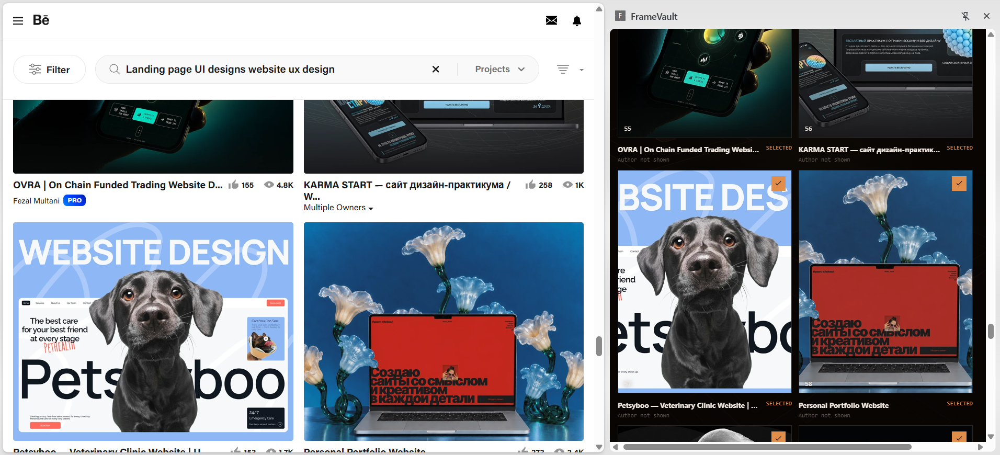

<p align="center">
  
</p>

<h1 align="center">FrameVault</h1>

<p align="center"><strong>Your next design starts with a reference worth keeping.</strong></p>

<p align="center">A Chrome extension that turns selected Behance and Dribbble images into an organized reference folder, complete with JSON and CSV metadata.</p>

<p align="center">
  <a href="#get-started">Get started</a> ·
  <a href="#supported-platforms">Supported platforms</a> ·
  <a href="#how-to-use-framevault">How it works</a> ·
  <a href="#development">Development</a> ·
  <a href="#contributing">Contribute</a>
</p>



*Real use on Behance. Artwork and platform branding in the screenshot belong to their respective owners.*

## Keep the reference. Keep the context.

Finding a great interface is easy. Remembering where you saved it is the part that gets messy.

FrameVault sits beside the page you are browsing. Scan the images already loaded on a supported page, choose the frames you want, and save them to a folder you approve. Each collection is organized by platform and search query, with metadata alongside the images.

Built for designers collecting visual references, developers studying interface patterns, and anyone building a library of UI inspiration.

## What you can do

- **Choose what you keep.** Review candidates in the side panel and select individual frames.
- **Save where you work.** Choose a destination using Chrome's native folder picker. Collection requires folder approval first.
- **Pick your image format.** Keep the original file, or convert locally to PNG or JPG.
- **Keep folders organized.** Images go into platform and query subfolders automatically.
- **Export useful metadata.** JSON and CSV include source image URLs, filenames, MIME types, byte sizes, SHA-256 hashes, and result status when available.
- **Control duplicate removal.** It starts off. Turn it on to skip images with identical saved content during that collection.
- **See progress and recover.** Follow collection progress, review failures, and retry only the frames that did not save.
- **Keep collections bounded.** Set a selection cap from 1 to 100 frames per run.

## Supported platforms

| Platform | Status | What works today |
| --- | --- | --- |
| Behance | Available | Scan loaded image candidates, select frames, and save approved image sources |
| Dribbble | Available | Scan loaded image candidates, select frames, and save approved image sources |
| Awwwards | Planned | Future adapter shown in the interface; scanning is not connected |
| Pinterest | Planned | Future adapter shown in the interface; scanning is not connected |

Support depends on page structure and approved image hosts. A platform can serve images through an external host that FrameVault does not currently permit. Those candidates are flagged for removal from the selection.

FrameVault does not scan arbitrary websites, automatically scroll through results, or open every project. New adapters need site-specific validation and a review of the relevant platform terms.

## Get started

The current installation method is to build FrameVault and load it as an unpacked Chrome extension. There is no Chrome Web Store installation link yet.

### 1. Build the extension

Use a current Chrome browser and Node.js 22.12 or newer with npm. From the project folder:

```bash
npm ci
npm run build
```

### 2. Load it in Chrome

1. Open `chrome://extensions`.
2. Enable **Developer mode**.
3. Select **Load unpacked**.
4. Choose the generated `dist` folder.
5. Pin FrameVault from Chrome's Extensions menu for quick access.

The installed extension works without the development server running.

### 3. Start your first collection

Open Behance or Dribbble and click the FrameVault extension icon. New installations start with an empty candidate grid and instructions to scan the page.

## How to use FrameVault

1. **Browse.** Search for the interface designs you want on Behance or Dribbble. Allow thumbnails to load.
2. **Scan.** Click **Scan current page**. Approve the requested site access if you want to continue.
3. **Select.** Review the candidates. The scanner initially selects the first 12; use individual cards, **Select visible**, or **Clear** to adjust.
4. **Choose a destination.** Pick a local folder. FrameVault remembers the folder handle, although Chrome may ask for approval again later.
5. **Set save rules.** Choose Original, PNG, or JPG. JSON and CSV exports start enabled. Duplicate removal starts off.
6. **Collect.** Click **Collect selected** and approve image-host access when prompted. Keep the panel open until saving finishes.
7. **Review.** Check the saved count and destination. Expand failure details or use **Retry failed frames** when needed.

Controls are locked during collection to prevent another action from interrupting file writes.

## Your files, in order

Example output:

```text
UI References/
  behance/
    landing-page-design/
      001-frame.png
      002-frame.png
      metadata-<run-id>.json
      metadata-<run-id>.csv
  dribbble/
    mobile-banking/
      001-frame.jpg
      metadata-<run-id>.json
      metadata-<run-id>.csv
```

Each run has unique metadata filenames, so a retry does not replace the previous report. Image filenames use candidate positions. Collecting again into the same platform and query folder can replace images with matching filenames.

## Image formats and duplicates

| Setting | Behavior |
| --- | --- |
| Original | Keeps downloaded image bytes and the source format, which may be WebP |
| PNG | Converts the downloaded image locally to PNG |
| JPG | Converts locally to JPEG at quality 0.92 and fills transparent areas with white |
| Duplicate removal off | Saves each selected candidate even if its content matches another |
| Duplicate removal on | Compares SHA-256 hashes of output bytes and skips matching content within the current run |

Repeated image URLs are removed during scanning in either mode. The switch controls content matching during saving. It does not search existing folders or identify visually similar images with different file contents.

Converting an image does not increase its resolution. PNG and JPG exports of animated sources contain a static frame.

## Privacy and permissions

FrameVault has no account system, analytics service, or application server. Image conversion, hashing, and file writing happen on your computer. Downloads still contact approved image hosts, and Chrome requests permission for those hosts when needed.

| Permission | Purpose |
| --- | --- |
| `sidePanel` | Displays the collector beside the page |
| `scripting` | Connects the page scanner when a supported tab needs it |
| `storage` | Declared in the manifest; current folder-handle persistence uses IndexedDB |
| Optional Behance and Dribbble host access | Reads candidates and downloads approved image sources |
| Chosen destination folder | Writes images and metadata inside the folder you approve |

Downloaded responses must use HTTPS and an image MIME type. The download path applies a request timeout and a 25 MiB image size limit. Failed or incomplete transfers are rejected before saving.

## Development

FrameVault uses React, TypeScript, Vite, and Chrome Manifest V3.

```bash
npm ci
npm run dev
```

Open the local URL printed by Vite to preview the interface. Scanning requires the installed extension. The localhost page starts empty and explains this when Scan is clicked.

After changing extension code:

```bash
npm run build
```

Reload FrameVault at `chrome://extensions`, refresh the supported website, and reopen the panel.

### Checks

```bash
npm run typecheck
node --experimental-strip-types --test tests/collection.test.mjs
npm run build
```

Regression tests cover binary integrity across JSON messages, invalid transfers, temporary file-state conflicts, and bounded retries. Also check live behavior in the installed extension because platform markup can change.

### Project map

```text
public/
  icons/                    PNG icons for Chrome and the favicon
  framevault-mark.svg        Source vector mark
  manifest.json             Manifest V3 configuration
src/
  background/               Approved-host image downloads
  content/                  Current-page image scanning
  core/                     Types, transfer encoding, hashing, file writes
  sidepanel/                React interface and collection workflow
scripts/
  generate-icons.ps1        Rebuild the existing mark as PNGs on Windows
tests/
  collection.test.mjs        Transfer and file-writing regression checks
docs/
  images/                   Repository screenshots
```

To regenerate icons on Windows, run `powershell -File scripts/generate-icons.ps1` in an environment that permits local scripts, then rebuild. The PNGs are committed, so other platforms do not need this script to install FrameVault.

## Troubleshooting

**The scan finds nothing.** Use the installed extension on Behance or Dribbble. Let thumbnails load, approve site access, and refresh the page after reloading FrameVault.

**An image is outside the source policy.** Use **Remove flagged** to deselect it. The current download policy accepts approved Behance and Dribbble hosts only.

**Chrome asks for folder access again.** Choose the destination again and retry. Permissions can expire between sessions.

**A file is busy or changed on disk.** Close it in another application and retry the failed frame. Temporary write conflicts are retried up to three times.

**Original saves WebP files.** That is the source format. Choose PNG or JPG before collecting if you need another file type.

## Contributing

Useful contributions include reproducible bug reports, accessibility improvements, page-scanning fixtures, and carefully scoped adapter proposals.

For bugs, include the Chrome version, a supported page URL if safe to share, output format, and failure message. Remove personal folder paths and private information from screenshots or metadata first.

For a new platform, describe the page types, image hosts, and how the adapter would respect the site's terms. Start with a small issue before building a broad crawler.

There is currently no project license file. Review that before reusing or redistributing the source. Dependencies have their own licenses.

## Respect the work you collect

Use FrameVault where the site's terms and your permissions allow downloading. Images remain the work of their creators. Collecting a reference does not grant permission to republish, resell, or reuse it in a finished design.

FrameVault is independent and is not affiliated with Behance, Dribbble, Awwwards, Pinterest, or Google.

## Help FrameVault grow

If FrameVault earns a place in your workflow, give the repository a star so you can find it again. Share it with a designer who keeps a crowded downloads folder, report a useful issue, or contribute a small improvement.

Good references deserve a better home.
